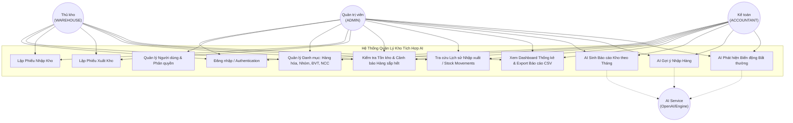

# 04. PHÂN TÍCH ACTOR VÀ USE CASE DIAGRAM

---

## 1. PHÂN TÍCH CÁC TÁC NHÂN (ACTORS)

1. **Quản trị viên (ADMIN)**: Người có quyền cao nhất trong hệ thống, quản lý tài khoản người dùng, xem toàn bộ dữ liệu danh mục, kho, báo cáo và tính năng AI.
2. **Thủ kho (WAREHOUSE)**: Người chịu trách nhiệm vận hành kho hàng ngày, lập phiếu nhập kho, lập phiếu xuất kho, theo dõi số lượng tồn và lịch sử nhập xuất.
3. **Kế toán (ACCOUNTANT)**: Người theo dõi số liệu báo cáo tài chính kho, xem báo cáo xuất-nhập-tồn, chỉ số tồn tối thiểu và nhận kết quả phân tích báo cáo từ AI.
4. **Hệ thống AI (AI SERVICE)**: Tác nhân tự động nhận yêu cầu từ hệ thống, phân tích dữ liệu JSON snapshot và sinh câu trả lời nhận xét/gợi ý.

---

## 2. BIỂU ĐỒ USE CASE (USE CASE DIAGRAM)

---

## 3. MÔ TẢ MA TRẬN QUYỀN TRUY CẬP USE CASE

| Use Case | ADMIN | THỦ KHO | KẾ TOÁN | Chú thích |
| :--- | :---: | :---: | :---: | :--- |
| **UC1: Đăng nhập** | ✅ | ✅ | ✅ | Xác thực JWT Token |
| **UC2: Quản lý Người dùng** | ✅ | ❌ | ❌ | Tạo, sửa, khóa tài khoản |
| **UC3: Quản lý Danh mục** | ✅ (CRUD) | 👁️ (Xem) | 👁️ (Xem) | Hàng hóa, Nhóm, ĐVT, NCC |
| **UC4: Lập Phiếu Nhập** | ✅ | ✅ | 👁️ (Xem) | Cập nhật tăng tồn kho |
| **UC5: Lập Phiếu Xuất** | ✅ | ✅ | 👁️ (Xem) | Chống xuất vượt tồn kho |
| **UC6: Xem Tồn Kho & Cảnh Báo** | ✅ | ✅ | ✅ | Theo dõi tồn < min_stock |
| **UC7: Tra cứu Lịch sử** | ✅ | ✅ | ✅ | Nhật ký Stock Movements |
| **UC8: Dashboard & Báo cáo** | ✅ | ✅ | ✅ | Biểu đồ & Xuất CSV |
| **UC9: AI Báo cáo Kho** | ✅ | 👁️ (Xem) | ✅ | Tổng hợp nhận xét AI |
| **UC10: AI Gợi ý Nhập Hàng** | ✅ | ✅ | ✅ | Phân tích burn rate |
| **UC11: AI Biến động Bất thường**| ✅ | 👁️ (Xem) | ✅ | Phát hiện đột biến |
